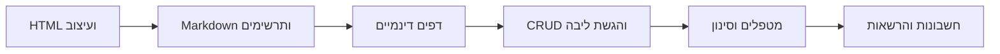

{: .box-note}
כאן תמצאו את הדרך לבניית האתר שלכם: מדף HTML ראשון, דרך עיצוב ומאמרים, ועד טפסים ששומרים נתונים. פתחו את השיעור שבו אתם נמצאים והמשיכו לבנות.

<!-- lesson-back:start -->
[הפרק הבא: 01 — הדף הראשון שלי]({{ '/taba/01-first-page/' | relative_url }}){: data-sequence-nav="next"}

במסך מגע אפשר להחליק ימינה לפרק הבא.

[חזרה: הפרויקט שלנו: מאתר אישי ליישום עם נתונים]({{ '/taba/00-teacher-plan/' | relative_url }})
<!-- lesson-back:end -->

## איך מתחילים?

צרו קובץ HTML ופתחו אותו בדפדפן. בשיעור הבא תריצו את האתר בסביבת הפיתוח, כשהדפדפן פתוח לצד העורך, ותראו את השינויים ב־HTML וב־CSS.

## מתרגול חופשי לפרויקט שנתי

| שלב | איך עובדים? |
| ---: | ---: |
| שיעורים 01–05, כולל מדריכי ההקמה | מתנסים ב־HTML, יוצרים פרויקטי Razor בשמות חופשיים ומתרגלים תוכן, CSS ו־Bootstrap. אפשר ליצור כמה ניסויים בתיקיות נפרדות; עדיין אין חובת שיתוף ב־GitHub. |
| שיעור 06 — Git ו־GitHub | בוחרים אתר עובד להמשך, רושמים מאגר פרטי בשם האישי ומוודאים גישה למורה. זו נקודת המעבר לפרויקט השנתי. |
| משיעור 08 והלאה | מוסיפים יכולות לאותו פרויקט ולאותו מאגר, שומרים commits משמעותיים עם הודעות ברורות ומעלים את ההתקדמות לאורך השנה. |

## הרגל שעוזר לאורך השנה

בשיעורים הראשונים שומרים קבצים, מריצים ומתנסים בתוכן ובעיצוב. תחילה עובדים ב־HTML בלי פרויקט, ואז מתרגלים יצירת פרויקטי Razor בשמות חופשיים; אפשר ליצור כמה ניסויים בתיקיות נפרדות. אחרי Bootstrap תלמדו לשמור גרסאות ב־Git ולפרסם מאגר פרטי ב־GitHub. רק לאחר חיבור המאגר מתחילים להשתמש בשגרה הבאה. בתחילת העבודה: Pull. במהלך העבודה: commits קטנים ומשמעותיים. בסיום: Commit ו־Push ובדיקה ב־GitHub. לפחות 50 commits לאורך השנה, גם אם עובדים תמיד באותו מחשב נייד. אם מופיעה התנגשות פונים למורה ושומרים על העבודה.

{: .box-note}
אחרי Bootstrap, ב[06 — שיעור Git ו־GitHub]({{ '/taba/06-git-github/' | relative_url }}), תרשמו פרויקט שנתי אחד במאגר פרטי בשם `FirstNameLastNameRazor` — השם הפרטי ושם המשפחה שלכם באנגלית, ואחריהם `Razor`, ללא רווחים. תזמינו את `3strategy` כ־Collaborator ותוודאו שהמורה יכול לגשת לקוד ולעזור לכם. המורה יעריך את ההשקעה המתמשכת לאורך השנה, את תוכן השינויים ואת הודעות ה־Commit הברורות, יחד עם ההסברים שלכם. העלאה אחת ברגע האחרון אינה מציגה את תהליך העבודה הזה.

## מה נבנה?

| יחידה | מסלול |
| ---: | ---: |
| [01 — הדף הראשון שלי]({{ '/taba/01-first-page' | relative_url }}) | ליבה |
| [02 — סביבת הפיתוח: מריצים ומשנים אתר]({{ '/taba/02-development-environment' | relative_url }}) | ליבה |
| [הקמה ב־VS Code: טרמינל ופרויקט Razor]({{ '/taba/02-setup-vscode/' | relative_url }}) | בוחרים מסלול הקמה אחד |
| [הקמה ב־Visual Studio: פתרון ופרויקט Razor]({{ '/taba/02-setup-visual-studio/' | relative_url }}) | בוחרים מסלול הקמה אחד |
| [הקמה ב־Rider: פתרון ופרויקט Razor]({{ '/taba/02-setup-rider/' | relative_url }}) | בוחרים מסלול הקמה אחד |
| [03 — האתר הופך לשלי]({{ '/taba/03-my-theme' | relative_url }}) | ליבה |
| [04 — מעצבים עם CSS]({{ '/taba/04-css-classes' | relative_url }}) | ליבה |
| [05 — אתר שנראה טוב עם Bootstrap]({{ '/taba/05-bootstrap' | relative_url }}) | ליבה |
| [06 — שומרים גרסאות עם Git ומפרסמים ב־GitHub]({{ '/taba/06-git-github/' | relative_url }}) | ליבה |
| [07 — מקום לשיעור נוסף]({{ '/taba/07-reserved/' | relative_url }}) | מקום לשיעור נוסף |
| [08 — מחברים דפים ובונים טופס]({{ '/taba/08-pages-and-forms' | relative_url }}) | ליבה |
| [09 — כותבים תוכן ב־Markdown]({{ '/taba/09-markdown' | relative_url }}) | ליבה |
| [10 — מציירים באמצעות טקסט: Mermaid]({{ '/taba/10-mermaid' | relative_url }}) | ליבה |
| [11 — מבינים את Razor Pages ואת התבנית המשותפת]({{ '/taba/11-razor-layout' | relative_url }}) | ליבה |
| [12 — הדף הדינמי הראשון]({{ '/taba/12-first-dynamic-page' | relative_url }}) | ליבה |
| [13 — מכרטיס HTML לאובייקט Animal]({{ '/taba/13-animal-model' | relative_url }}) | ליבה |
| [14 — מקום לשיעור נוסף]({{ '/taba/14-reserved/' | relative_url }}) | מקום לשיעור נוסף |
| [15 — הנתונים נשמרים עם EF Core ו־SQLite]({{ '/taba/15-ef-sqlite' | relative_url }}) | ליבה |
| [16 — מוסיפים חיה ובודקים קלט]({{ '/taba/16-create-validation' | relative_url }}) | ליבה |
| [17 — מעדכנים ומוחקים רשומות]({{ '/taba/17-edit-delete' | relative_url }}) | ליבה |
| [18 — משלימים ומציגים אתר אישי עם CRUD]({{ '/taba/18-core-project' | relative_url }}) | ליבה |
| [19 — מטפל וחיות: קשר אחד־לרבים]({{ '/taba/19-keepers-animals' | relative_url }}) | הרחבה |
| [20 — מנהלים מטפלים: CRUD וקשר קיים]({{ '/taba/20-keeper-crud' | relative_url }}) | הרחבה |
| [21 — מקום לשיעור נוסף]({{ '/taba/21-reserved/' | relative_url }}) | מקום לשיעור נוסף |
| [22 — מחפשים ומסננים נתונים]({{ '/taba/22-filtering' | relative_url }}) | הרחבה |
| [23 — הרשמה וכניסה עם Microsoft Identity]({{ '/taba/23-local-identity' | relative_url }}) | הרחבה |
| [24 — מרחיבים את פרופיל המשתמש]({{ '/taba/24-user-profile' | relative_url }}) | הרחבה |
| [25 — מי רשאי לערוך? בעלות והרשאות]({{ '/taba/25-authorization' | relative_url }}) | הרחבה |
| [26 — כניסה עם Google — הרחבת רשות]({{ '/taba/26-google-login' | relative_url }}) | הרחבה |
| [27 — מקום לשיעור נוסף]({{ '/taba/27-reserved/' | relative_url }}) | מקום לשיעור נוסף |

## נקודת הסיום הבסיסית

אתר אישי עם יצירה, קריאה, עריכה ומחיקה; בדיקת קלט; שמירה לאחר הפעלה מחדש; מאמר Markdown ותרשים שאתם מסבירים בעצמכם. לפני ההגשה ודאו שהטפסים פועלים ושהמידע נשמר גם לאחר הפעלה מחדש.

בכל תחנה תציגו למורה שינוי קטן ותסבירו את הקוד. AI יכול לסייע בהבנת שגיאה; הוא אינו כותב את הפרויקט במקומכם. בחרו בכל פעם משימה קטנה שאפשר להשלים, לבדוק ולשמור. לאחר שיעור Git שמרו גם ב־commit.

<!-- lesson-next:start -->
---

## המשך

- [המשך: 01 — הדף הראשון שלי]({{ '/taba/01-first-page/' | relative_url }})
<!-- lesson-next:end -->
